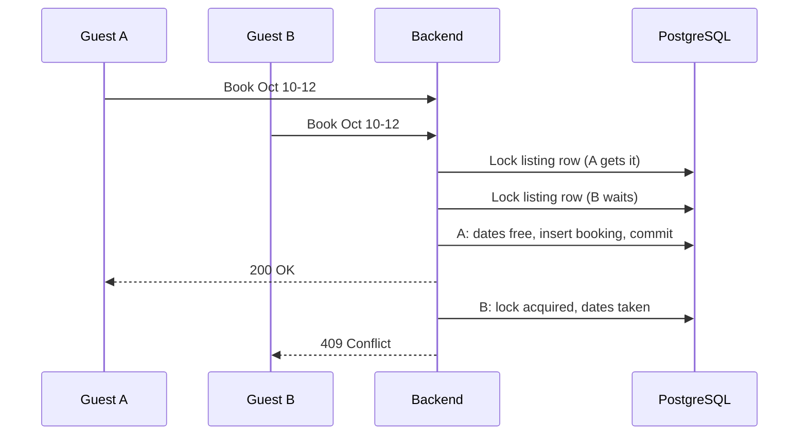
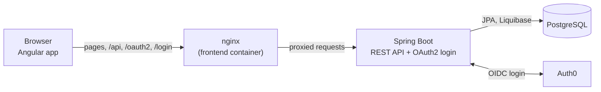

# Hearthway

<!-- TODO: replace TODO-USERNAME and TODO-BACKEND-REPO so the badge points at this repo -->
[](https://github.com/TODO-USERNAME/TODO-BACKEND-REPO/actions/workflows/ci.yml)

A homestay booking platform: hosts list their homes, guests search for a place and book
a stay. This repository is the **Spring Boot backend**; the
<!-- TODO: replace TODO-USERNAME and TODO-FRONTEND-REPO with the real frontend repo URL -->
[Angular frontend](https://github.com/TODO-USERNAME/TODO-FRONTEND-REPO) lives in its own
repository.

<!-- TODO: add the demo video link and a screenshot (e.g. docs/home.png) -->
**[Watch the 3-minute demo](TODO-VIDEO-LINK)**

## What it does

**Guests** browse homes by category, search by country, dates and number of guests,
check a home's availability on a calendar, book a stay and cancel their bookings.

**Hosts** list a home with a step-by-step wizard (category, location, rooms, photos,
description, price), see their listings and the reservations made on them, and can
cancel a reservation. Listing a first home makes a user a host.

## Highlights

**No double bookings, even under concurrent requests.** Booking a stay locks the
listing's row (`SELECT ... FOR UPDATE`), so requests for the same listing are handled
one at a time and the availability check sees the previous booking. A PostgreSQL
exclusion constraint on the booked date ranges backs this up at the database level. A
test fires 20 simultaneous bookings for the same nights and checks that exactly one
succeeds and the rest get a clean `409 Conflict`. That test first exposed a deadlock
when relying on the constraint alone, which is why the row lock was added.



**Stays are calendar days, not timestamps.** Check-in and check-out are stored as dates,
and a stay covers the nights from check-in up to, but not including, check-out. So a new
stay can start on the day the previous guest leaves, and a guest's time zone can't shift
their dates.

**Tokens never reach the browser.** The backend runs the OAuth2/OIDC login itself
(Spring Security's `oauth2Login`, a backend-for-frontend setup). The browser only holds
a session cookie, protected against CSRF with Angular's double-submit cookie support, so
there is no access token in JavaScript for an XSS bug to steal.

**Pictures are served by URL, not embedded in JSON.** List and detail responses carry
picture IDs; images come from `/api/pictures/{id}`, cached for a year and scaled to
the width a page needs. For a page of 10 listings:

| Response | Before | After |
|---|---|---|
| Home page listings (`get-all-by-category`) | 4.95 MB | 2.26 KB |
| One listing's details (`get-one`) | 12.15 MB | 3.69 KB |
| Whole home page, development build | 14.6 MB | 6.5 MB |

Response times stayed the same locally: the saving is in transfer, and the server still
reads picture bytes from the database (see [Known limitations](#known-limitations)).
Because uploaders choose the stored content type, only image types are served inline;
anything else is sent as a download, so an uploaded HTML file can't run on the app's
origin.

**Internal IDs stay internal.** Rows use database sequence IDs, but the API only exposes
UUIDs. Ownership is checked inside the queries (for example "delete this listing *if it
belongs to the current host*"), so guessing another user's IDs gets nowhere.

**Tested against a real database.** The integration tests start PostgreSQL with
Testcontainers, so they exercise the real migrations, the exclusion constraint and the
locking; that's how the deadlock described above was found before any real user could
hit it. CI runs them on every push.

## Architecture



nginx serves the Angular app and proxies API and login requests to the backend, so the
browser sees one origin and the session cookie just works.

The code is organised by feature, with layers inside each:

```
src/main/java/hearthway/
├── booking/          bookings: creation, availability, cancellation
├── listing/          listings, search and pictures
├── user/             users and the link to Auth0
├── sharedkernel/     small shared types
└── infrastructure/   security, database and clock configuration
```

Each feature has `presentation` (REST controllers), `application` (services and DTOs),
`domain` (JPA entities), `repository` and `mapper` (MapStruct) packages. Database
changes are versioned with Liquibase; applied changesets are never edited, so renames
and type changes are new migrations.

## Tech stack

- **Backend:** Java 21, Spring Boot 3.2 (Web, Security with OAuth2 client, Data JPA,
  Validation), Hibernate, Liquibase, MapStruct
- **Database:** PostgreSQL 17 (with the `btree_gist` extension for the booking
  constraint)
- **Identity:** Auth0 (OpenID Connect)
- **Frontend:** Angular 17, PrimeNG, Leaflet with OpenStreetMap
- **Testing:** JUnit 5, Spring Boot Test, Testcontainers, Karma/Jasmine
- **Delivery:** Docker, Docker Compose, nginx, GitHub Actions, Dependabot

## Running locally

### Prerequisites
- [JDK 21](https://adoptium.net/temurin/releases/)
- [Docker](https://docs.docker.com/get-docker/) (PostgreSQL runs in a container; the tests use Testcontainers)
- An Auth0 tenant configured for the app: a Regular Web Application with
  `http://localhost:4200/login/oauth2/code/okta` as a callback URL, the
  `ROLE_TENANT` and `ROLE_LANDLORD` roles, and a post-login Action that assigns the
  default role. This setup is being replaced by standard OIDC with roles stored in the
  app's own database and a bundled Keycloak, after which no external account will be
  needed.

### Clone the repository
<!-- TODO: replace TODO-USERNAME and TODO-BACKEND-REPO with the real backend repo URL -->
``git clone https://github.com/TODO-USERNAME/TODO-BACKEND-REPO``

### Configure
``cp .env.example .env`` and fill in `AUTH0_CLIENT_ID` and `AUTH0_CLIENT_SECRET`.
`.env` is git-ignored; the `dev` profile reads it, and so does Docker Compose.

### Run
The `dev` profile is used by default. Starting the app also starts PostgreSQL from
`compose.yaml` (Spring Boot Docker Compose support).

#### Maven or your IDE
``./mvnw spring-boot:run``, or run `hearthway.HearthwayApplication` from your IDE with
this folder as the working directory. Then start the frontend with `ng serve`.

#### Everything in containers
Clone the frontend next to this repository (or set `FRONTEND_DIR` in `.env`), then:

``docker compose --profile full up --build``

and open http://localhost:4200.

#### Tests
``./mvnw verify`` runs the test suite against a real PostgreSQL started by
[Testcontainers](https://testcontainers.com/), so Docker must be running. No Auth0
credentials or network access to Auth0 are needed.

## Deploying

The app is built to run behind a single origin, as it does in Docker Compose:

- A reverse proxy (nginx, or a platform's router) serves the Angular build and forwards
  `/api`, `/oauth2` and `/login` to the backend, over HTTPS.
- The backend runs with `SPRING_PROFILES_ACTIVE=prod` and gets its database from
  `POSTGRES_URL`, `POSTGRES_DB`, `POSTGRES_USER` and `POSTGRES_PASSWORD`, plus the Auth0
  credentials. Liquibase migrates the schema on startup.
- PostgreSQL must allow the `btree_gist` extension (most managed services do).
- The Auth0 application needs the production callback and logout URLs.
- To run more than one backend instance, sessions would need to be shared (for example
  with Spring Session on the same PostgreSQL); a single instance keeps them in memory.

## Known limitations

These are deliberate trade-offs for a portfolio project, roughly in the order I'd
address them:

- **Identity:** roles are assigned through the Auth0 Management API and read from a
  custom token claim, and local users are matched by email. Next step: key users on the
  OIDC subject, keep roles in the app's database, and make the identity provider a
  configuration choice (Auth0 or Keycloak).
- **Picture storage:** images are stored in PostgreSQL, and loading a listing also loads
  its picture bytes. Moving them to object storage (or at least out of the listing
  entity) would cut database load and server response times.
- **Booking lifecycle:** cancelling deletes the booking. A real platform needs states
  (requested, confirmed, cancelled, completed), cancellation policies and payments.
  Deleting a listing also deletes its bookings.
- **Abuse protection:** no rate limiting yet, and uploads are only checked for count,
  not file type or size beyond the 100 MB request limit.
- **Search:** location is country-level only; there is no map-area or amenity search.
- **Frontend:** Angular 17 and PrimeNG 17 are past end of support; upgrading means
  moving to PrimeNG's new theming system.

Deliberately out of scope: payments, reviews, messaging between hosts and guests,
notifications, calendar sync with other platforms, pricing rules (weekend or seasonal
rates, fees, taxes) and an admin back office.
